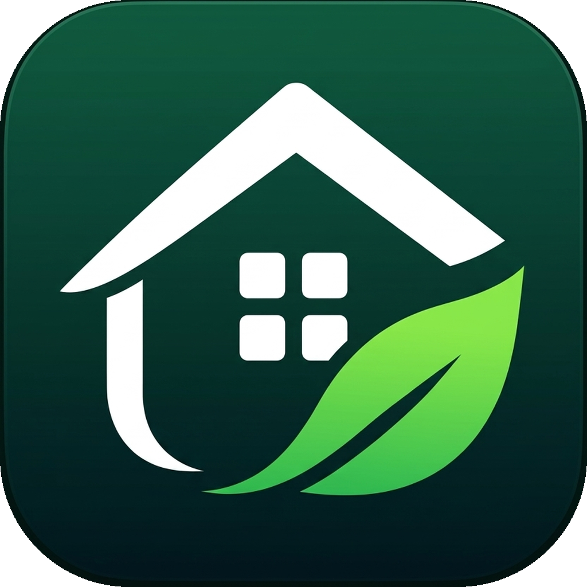

  

<h1 align="center">Kunjo Drive — v1.2.0</h1>

<b>Next-Generation Zero-Knowledge Liquid Glass Cloud Drive for Android & Desktop</b>

  
  

## Download

- **Android (Universal APK):** [DewanGram-KunjoDrive-v1.2.0-universal-release.apk](https://github.com/iplus009/KunjoDrive/releases/latest/download/DewanGram-KunjoDrive-v1.2.0-universal-release.apk)
- **Desktop (Windows `.msi`, Linux `.deb` / `.AppImage`, macOS `.dmg`) & All Versions:** [GitHub Releases](https://github.com/iplus009/KunjoDrive/releases/latest)

---

## Overview

**Kunjo Drive (কুঞ্জ ড্রাইভ)** transforms private encrypted cloud channels into a blazing fast, zero-knowledge personal & family cloud ecosystem across **Android** and **Desktop (Windows, Linux, macOS)** — with zero third-party relay servers.

### Flagship Highlights
- **Turbo IDM Acceleration Engine:** 4X-8X dynamic segmentation with zero-copy DMA byte writing directly to disk, parallel streams, and persistent chunk resume.
- **Built-in Kunjo Cinema & Music Studio:** NextPlayer/JustPlayer-grade video engine with 200% volume boost (+12dB), 2x hold-to-speed, and seamless background audio playback with AudioAttributes and CPU wake-lock protection.
- **Real GPU Liquid Glass Optical Engine (`glass-kit`):** Hardware-accelerated AGSL refraction & backdrop shaders on Android 13+ with Skia desktop rendering and **4 distinct dynamic themes** (`CyberGuard`, `Hussuu Cyber`, `Minimal Drive`, `Donut Neon`).
- **Official Release Signing & C++ SHA-256 Signature Pinning:** Production RSA 4096-bit keystore verification and tamper resistance inside native `libnovo_core.so`.
- **Login with Family (Zero-Knowledge 3-Slot Cloud):** Instant 1-scan encrypted QR login without requiring family members to own a Telegram account or API hash.
- **100% Offline On-Device OCR Search:** Find receipts, IDs, passports, and notes by searching text inside images privately on-device.
- **Smart Storage Suite:** Content-hash Duplicate & Big File Cleaner, File Version History (`v1`, `v2`...), Bedtime Night-Window Backup & Anti-Ban Safe Bandwidth Limiter, Decoy Dual-PIN Vault, Password-Protected `.zip` Sharing, and Local Wi-Fi / Smart TV Stream Bridge.

## Architecture
- `:shared` — Kotlin Multiplatform domain, repositories, Room `v18` database, zero-knowledge cryptography, family policy engine, OCR index, and local stream bridge.
- `:ui` — Compose Multiplatform presentation layer, 4-theme engine, procedural optical splash screen, and KMP `OpticalGlassBridge`.
- `:android` — Android app target, Native C++ NDK security core, WorkManager background sync & keep-alive workers, Media3 player, and ML Kit offline OCR.
- `:desktop` — Windows, Linux, and macOS desktop target powered by Compose Desktop, TDLight, and VLCJ.

## License
Licensed under the [Apache License, Version 2.0](LICENSE). See [NOTICE](NOTICE) for open-source attributions.
